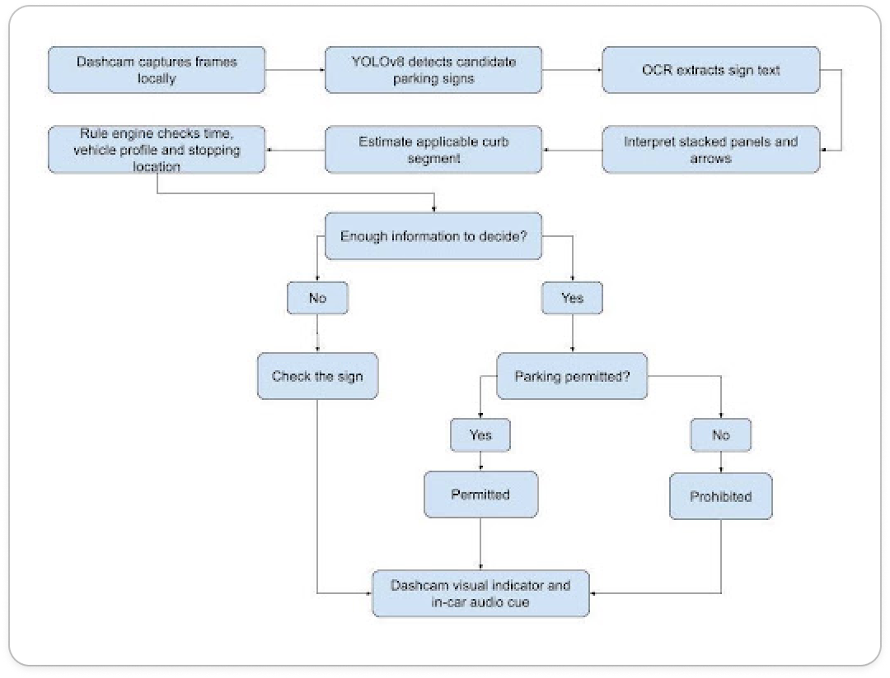

# Overview

Offsider is an end-to-end computer vision and rule-evaluation system designed to eliminate parking uncertainty.

Delivery drivers operate under tight window drops, where reading complex parking signs from the cab is confusing and error-prone, often resorting to one's own intuition to validate parking. 

Parking signage changes frequently, especially in dense areas. A high-pressure environment, combined with lack of present knowledge around local parking laws leads to an excess of parking tickets for drivers.

Offsider pairs object detection with optical character recognition (OCR) to frame parking signs, transcribe regulatory text, and validate parking permissions against the current vehicle classification and timestamp, in real-time.

---

## Architecture Pipeline

<p align="center">
  
  <br>
  <em>Figure 1: High-level system flow diagram (work-in-progress prototype).</em>
</p>

---

## Repository Structure

```text
offsider/
├── data/                  # Local training sets (ignored by git)
├── docs/
|   ├── assets/            # Images
│   └── index.html         # Project landing page
├── fixtures/              # Test fixtures and unit test inputs
│   └── sample_crops/      # Pre-cropped signage for mock evals
├── models/                # Local model (ignored by git)
│   └── best.pt
├── notebooks/             # Analysis, training, evals
│   └── training.ipynb
├── src/                   # Core application logic
│   ├── pipeline.py        # Sign detector
|   ├── ocr.py             # Text extractor
│   └── rules.py           # Rule parser
├── streamlit_app/         # Streamlit prototype
|   ├── app.py
|   └── requirements.txt
├── app.py
├── pyproject.toml         # Environment configuration
└── README.md
```

# Getting Started

### Prerequisites
  - Python 3.12 or higher
  - Git

### Installation

1. Clone the repo:
   
    `git clone https://github.com/offsider-labs/offsider.git`

2. Create and activate virtual environment:

    `uv venv && uv sync`

### Model Weights Setup

Model weight binaries (.pt) are tracked outside of Git.

1. Download the latest trained checkpoint from our [latest pre-release](https://github.com/offsider-labs/offsider/releases/).
2. Place the weights file inside `models/` directory:

```bash
mkdir -p models
mv ~/Downloads/best.pt models/best.pt
```

## Usage

### Running the Interactive UI

`streamlit run steamlit_app/app.py`

## Contributors & Team

__David Van Kriedt__ - Main Developer

__Aryan Gupta__ - Main Developer
