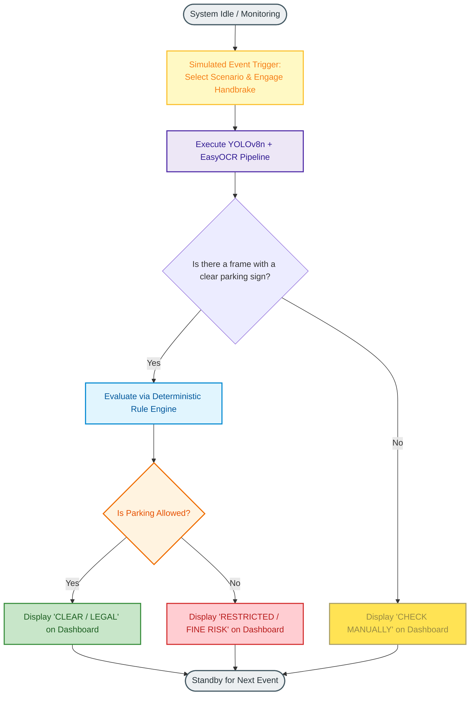

# Overview

Offsider is an end-to-end computer vision and rule-evaluation system designed to eliminate parking uncertainty.

Delivery drivers operate under tight window drops, where reading complex parking signs from the cab is confusing and error-prone, often resorting to one's own intuition to validate parking. 

Parking signage changes frequently, especially in dense areas. A high-pressure environment, combined with lack of present knowledge around local parking laws leads to an excess of parking tickets for drivers.

Offsider pairs object detection with optical character recognition (OCR) to frame parking signs, transcribe regulatory text, and validate parking permissions against the current vehicle classification and timestamp, in real-time.

---

Landing Page: https://offsider-labs.github.io/offsider/

## Architecture

```mermaid
graph TD
    subgraph In-Vehicle Edge System
        A["Live Dashcam Video Stream"] --> B["Vehicle State Monitor<br>(Handbrake / Shift to Park)"]
        B -->|Trigger Event| C["Frame Capture Buffer"]
        C --> D["YOLOv8n Object Detector<br>(Sign Localization)"]
        D --> E["EasyOCR Engine<br>(Text Extraction)"]
        E --> F["Deterministic Rule Parser<br>(Time, Day & Limit Match)"]
        F --> G["Driver Dashboard UI Feedback"]
    end

    style A fill:#E3F2FD,stroke:#1565C0,stroke-width:2px,color:#0D47A1
    style B fill:#FFF9C4,stroke:#FBC02D,stroke-width:2px,color:#F57F17
    style C fill:#E8F5E9,stroke:#2E7D32,stroke-width:2px,color:#1B5E20
    style D fill:#EDE7F6,stroke:#512DA8,stroke-width:2px,color:#311B92
    style E fill:#EDE7F6,stroke:#512DA8,stroke-width:2px,color:#311B92
    style F fill:#E8F5E9,stroke:#2E7D32,stroke-width:2px,color:#1B5E20
    style G fill:#E1F5FE,stroke:#0288D1,stroke-width:2px,color:#01579B
```




## Demo User Flow



---

## Repository Structure

```text
offsider/
├── data/                  # Local training sets (ignored by git)
├── docs/
|   ├── assets/            # Images
│   └── index.html         # Project landing page
├── fixtures/              # Test fixtures and unit test inputs
│   └── sample_crops/      # Pre-cropped signage for mock evals
├── models/                # Local model (ignored by git)
│   └── best.pt
├── notebooks/             # Analysis, training, evals
│   └── training.ipynb
├── src/                   # Core application logic
│   ├── pipeline.py        # Sign detector
|   ├── ocr.py             # Text extractor
│   └── rules.py           # Rule parser
├── streamlit_app/         # Streamlit prototype
|   ├── app.py
|   └── requirements.txt
├── app.py
├── pyproject.toml         # Environment configuration
└── README.md
```

# Getting Started

### Prerequisites
  - Python 3.12 (recommended) or 3.13
  - Git

### Installation

1. Clone the repo:
   
    `git clone https://github.com/offsider-labs/offsider.git`

2. Create and activate virtual environment:

    `uv venv && uv sync`

### Model Weights Setup

Model weight binaries (.pt) are tracked outside of Git.

1. Download the latest trained checkpoint from our [latest pre-release](https://github.com/offsider-labs/offsider/releases/).
2. Place the weights file inside `models/` directory:

```bash
mkdir -p models
mv ~/Downloads/best.pt models/best.pt
```

## Usage

### Running the Interactive UI

`streamlit run streamlit_app/app.py`

### Deploying to Streamlit Community Cloud

Use `main` as the branch and `streamlit_app/app.py` as the entry point.
Before deploying, open **Advanced settings** and select **Python 3.12**.
PaddlePaddle requires Python below 3.14 for the versions used here.
The repository's `.python-version` configures local tooling; Cloud's Python
version must be selected in the deployment settings.

If an existing deployment uses Python 3.14, save its secrets and settings,
then delete and redeploy the app with Python 3.12. Rebooting the app or pushing
dependency changes does not change its Python runtime.

## Data Practices

Offsider uses two distinct sets of street-sign imagery: a **110-image training dataset** for custom `YOLOv8` sign detection and a **20-image evaluation dataset** (expanded into **37 scenario rows**) for end-to-end compliance scoring.

### 1. YOLO Training Dataset (~110 Images)
* **Sources:** 110 street-sign images collected from the real world, and Google Maps, covering parking and kerbside restriction signs (such as timed parking, `No Stopping`, `Clearway`, `Bus Zone`, and `Taxi Zone` signs) across varied angles, lighting, and distances.
* **Preparation & Annotation:** Images were labelled with bounding boxes in YOLO format (`Roboflow`) and prepared using auto-orientation, and resizing to 640x640 (optimal for YOLO model).
* **Data Quality & Scope:** Signs were annotated for localisation rather than fine-grained spatial arrow geometry or multi-plate pole relationships.

### 2. Evaluation Dataset (20 Images / 37 Scenarios)
* **Sources:** 20 real street-sign images (`valid-1.png`–`valid-5.png` and `invalid-1.png`–`invalid-15.png`) captured from Google Maps street imagery in NSW, evaluated across **37 scenario combinations** in `eval/expected-verdicts.csv` varying `day` (`MON`, `TUE`, `SAT`, `SUN`), `time` (`07:00`, `12:00`, `23:00`), and `vehicle` class (`sedan`).
* **Repeatable Prep & Scoring:** Images are stored in `eval/test-images/` and paired with ground-truth verdicts (`expected_status`, `expected_active`, `expected_max_stay_minutes`) and rule rationales (`basis`). Evaluation runs reproducibly via `eval/score_pipeline.py` using the real YOLO detector (`use_mock == False`).
* **Train / Tuning vs. Evaluation Separation:** The 20 evaluation images are separate from the 110 YOLO training images. [State accurately whether any of the 20 eval images were viewed/used while tuning regex rules or confidence thresholds, or whether they were held back—if any were used for debugging/tuning, note that explicitly rather than claiming a blind split.]

### 3. Licensing, Privacy & Known Data Limitations
* **Licensing"** Street-sign imagery sourced from Google Maps is used strictly for non-commercial COMP3110 academic evaluation with attribution to Google Maps; Google mapping/Street View imagery remains proprietary to Google and its data providers and is not redistributed under an open license. Object detection relies on Ultralytics YOLOv8 (AGPL-3.0, which permits academic/open-source use under AGPL-3.0 terms while commercial/closed-source deployments require an Ultralytics Enterprise license), and text recognition relies on PaddleOCR (Apache-2.0).
* **Privacy:** Images focus on public street signage; where street scenes include surrounding surroundings, no private identities or sensitive personal records are intentionally collected or exposed.
* **Known Limitations (Spatial & Stacked Signs):** Complex multi-plate stacked signs and split directional signs (such as opposing left/right restrictions like `No Stopping` vs. `1P` on opposite sides) were excluded or flagged as out-of-scope for v1 because Offsider does not currently model arrow direction or vehicle-relative spatial side. These remain documented limitations for future spatial/arrow parsing work.

## Contributors & Team

__David Van Kriedt__ - Main Developer

__Aryan Gupta__ - Main Developer
